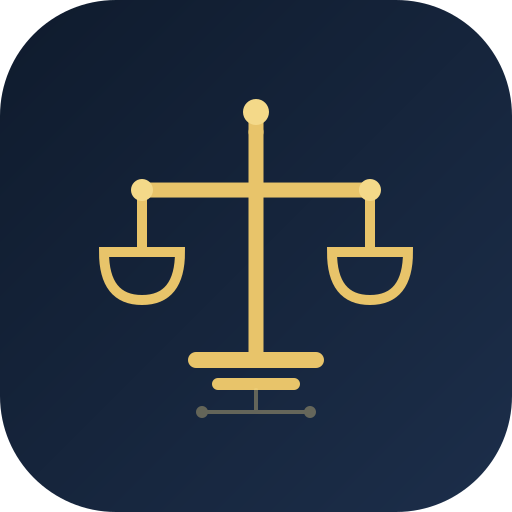

  
  <h1>law-products</h1>
  
<strong>法律科技 · 把办案经验变成可复用的 AI 技能与工具</strong>

  

    
    
    
  

---

## 这条线在做什么

把律师的日常拆成三件事，分别用代码解决：

| 层面 | 内容 | 代表项目 |
|---|---|---|
| 知识 | 办案流程、文书模板、审查要点，结构化成可检索的资产 | `skills-for-legal` |
| 技能 | 让 Claude Code / Codex / DeepSeek Harness 直接执行法律任务 | `skills-for-legal` |
| 工具 | OCR、脱敏、文书生成、检索，解决重复劳动 | `doc-anonymizer` · `doc-flip-video` |

## 公开项目

### [skills-for-legal](https://github.com/law-products/skills-for-legal)

面向中国法律实务的 AI 技能与插件集。13 个业务领域 + 跨领域能力层（法院短信 / OCR / 文章抓取 / 法规检索），支持 Claude Code、Codex、DeepSeek Harness、WorkBuddy。

### [doc-anonymizer](https://github.com/law-products/doc-anonymizer)

本地文档脱敏。中文优先、全离线、保留原格式。适合在把客户材料交给外部模型之前做一次清理。

### [doc-flip-video](https://github.com/law-products/doc-flip-video)

从 JSON 配置生成红头文件风格的翻页高亮动画视频。适合法律内容演示与普法短视频。

## 适合谁

- 想用 AI 提效的执业律师、法务
- 做法律科技产品的开发者
- 研究法律 AI 落地的团队

## 从这里开始

1. 想直接用 → [`skills-for-legal`](https://github.com/law-products/skills-for-legal) 的 QUICKSTART
2. 想先体验工具 → [`doc-anonymizer`](https://github.com/law-products/doc-anonymizer)
3. 想看工程怎么组织 → 每个仓库的 README 与 AGENTS.md

## 原则

- **知识公开，业务私有**：客户、案件、律所内部交付不出现在公开仓库
- **可运行优先**：每个公开项目都能在本地跑起来
- **中文优先**：面向中国法律实务，不假设英文语境